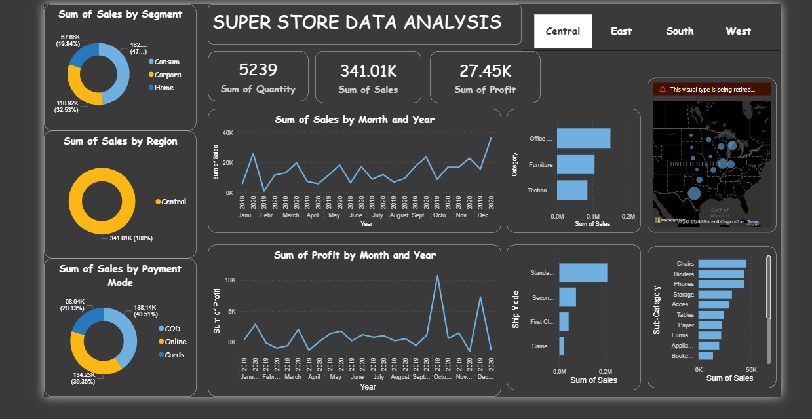

# Superstore Sales Analysis (SQL + Power BI)

Analysis of 2 years of US Superstore sales (2019 to 2020) to find which regions, categories, segments and payment modes drive sales and profit.

## Business questions
1. What are total sales, profit, orders and margin?
2. Which regions and categories drive sales, and which drive profit?
3. Where is the business losing money?
4. How are sales trending month to month and year over year?
5. How do customers pay, and which customers matter most?

## Dataset
5,901 order lines | 3,003 orders | 773 customers | Jan 2019 to Dec 2020
Columns include order and ship dates, region, state, segment, category, sub-category, sales, quantity, profit, returns and payment mode.

## Approach
1. **Clean** (`python/clean_data.py`): fixed a broken column header, converted dates to `YYYY-MM-DD`, dropped empty helper columns, standardised the returns flag.
2. **Check data quality** (`sql/02_data_quality_checks.sql`): missing values, impossible values, ship-before-order dates.
3. **Analyze in SQL** (`sql/03_business_analysis.sql`): 12 business queries using aggregations, `CASE WHEN`, CTEs and window functions (`LAG`, `DENSE_RANK`, `SUM() OVER ()`).
4. **Visualize in Power BI** (`dashboard/`): interactive dashboard with DAX measures, a region slicer, monthly trends and category, segment and payment-mode breakdowns.

## Key findings
| Metric | Value |
| --- | --- |
| Total sales | $1,565,804 |
| Total profit | $175,262 (11.2% margin) |
| Orders | 3,003 |
| Average order value | $521 |

- **West is the top region**: 33.4% of sales and the highest profit ($67.9K).
- **Office Supplies leads sales (41.1%)**, but **Technology earns the most profit** ($90.5K at a 19.2% margin).
- **Furniture barely breaks even** (2.2% margin) because **Tables lose $11.1K**; Bookcases and Supplies also lose money.
- **Sales grew strongly in 2020** in every region, led by the South (+84.5%) and Central (+82.5%).
- **Cash on delivery is the most used payment mode** (42.6% of sales).
- **Consumers are the biggest segment** (48.1% of sales, $81.3K profit).

## Recommendations
- Review pricing and discounts on **Tables** to stop losses in Furniture.
- Promote high-margin **Technology** products in the West and East.
- Make online payment easier to reduce reliance on cash on delivery.

## Dashboard

*Shown with the Central region selected.*

## How to run
```bash
pip install pandas
python python/clean_data.py          # creates data/superstore_clean.csv
```
Then in MySQL 8 (Workbench or command line), run the files in `sql/` in order: `01`, `02`, `03`.
Open `dashboard/Superstore_Sales_Analysis.pbix` in Power BI Desktop.

## Project structure
```
├── data/        raw and cleaned CSVs
├── python/      clean_data.py
├── sql/         01_create_and_load, 02_data_quality_checks, 03_business_analysis
└── dashboard/   Power BI file and screenshot
```

## Tools
SQL (MySQL) · Power BI · DAX · Power Query · Python (Pandas)
